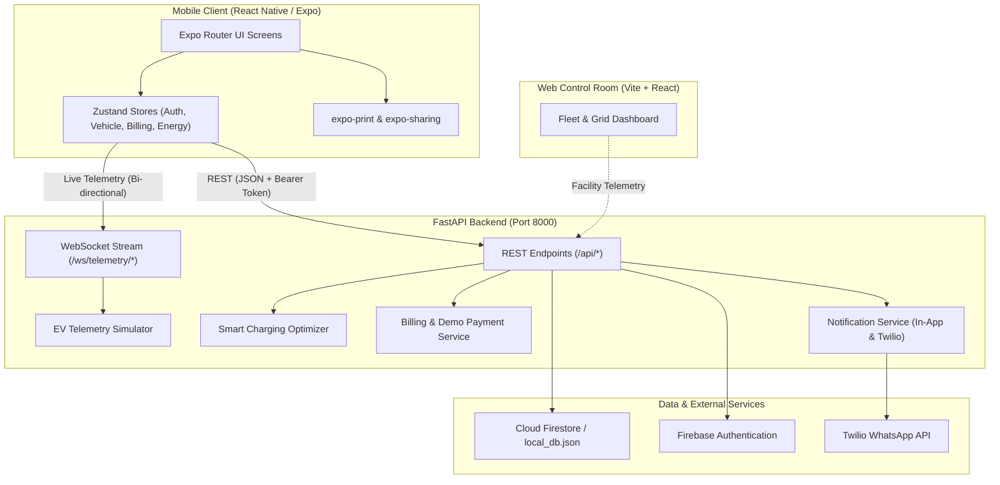

# VoltFlow — Intelligent EV Charging & Energy Management Platform

VoltFlow is an end-to-end electric vehicle (EV) charging and energy management platform designed to optimize charging schedules, reduce grid stress, lower energy costs, and provide drivers with transparent billing and real-time charging insights.

The platform consists of:
- **Mobile Application**: A cross-platform React Native / Expo app for EV owners and fleet drivers.
- **Backend API**: A high-performance FastAPI service providing vehicle simulation, smart charging optimization, charger discovery, reservations, billing, and WebSocket telemetry streams.
- **Web Control Room**: A grid-operator and fleet management dashboard built with React and Vite for real-time facility load monitoring.

---

## Key Features

### 1. Driver Onboarding & Vehicle Management
- User authentication with Firebase Authentication and local demo session fallback.
- Multi-step driver profile setup (personal details, property type, charging preferences).
- Multi-vehicle support: register vehicles, track battery capacity (kWh), battery health (SoH), current SoC, and range.

### 2. Live Charging Session & Simulator
- Real-time monitoring of charging power (kW), delivered energy (kWh), elapsed duration, and estimated completion time.
- Integrated background EV telemetry simulator supporting virtual sessions, charge rate variations, and emergency boost ("Charge Faster").
- "Why did my charging change?" explainability card that clearly communicates grid-load and solar-curtailment adjustments to drivers.

### 3. Smart Charging Schedule & Optimization
- 24-hour automated charging plans that shift energy draw into off-peak tariff and high-solar availability windows.
- Contract-based `OptimizerService` with built-in heuristic simulation for solar self-consumption and peak shaving.

### 4. Charger Discovery & Reservations
- Station exploration with connector types (CCS2, Type 2, CHAdeMO), real-time availability, and pricing.
- Slot reservation system with a 15-minute grace period and double-booking conflict prevention.

### 5. Charging History & Battery Analytics
- Historical session browser filterable by Day, Week, and Month.
- Battery degradation tracking, clean renewable energy share percentage, and detailed session audits.

### 6. Billing, Demo Payment & Invoice Flow
- Comprehensive billing statements breaking down energy consumption, parking bay fees, and convenience fees in INR (₹).
- **Simulated Demo Payment**: A hackathon demo payment modal allowing drivers to test payment flows using UPI (Demo), Card (Demo), or Wallet (Demo) without processing real financial transactions.
- **Invoice Generation & PDF Export**: Instant professional tax invoice modal with printable/downloadable PDF generation via `expo-print` and `expo-sharing`, fully functional inside **Expo Go**.

### 7. Multi-Channel Notifications
- In-app notification center for charging started, target SoC reached, billing receipts, and scheduled departures.
- Twilio WhatsApp integration for external dispatch of charging alerts and reservation confirmations.
- Expo Go-safe architecture: remote native push notifications are safely bypassed in Expo Go (per Expo SDK 53+ rules) while preserving native build handlers.

### 8. Web Control Room (Admin Dashboard)
- Facility-level transformer load monitoring, dynamic solar generation tracking, and fleet-wide charging orchestration.

---

## Technology Stack

| Component | Technologies & Libraries |
| :--- | :--- |
| **Mobile App** | React Native `0.86.3`, React `19.2.3`, Expo SDK `~57.0.24`, Expo Router `~57.0.22`, TypeScript `~6.0.3` |
| **Mobile State & Storage** | Zustand `^5.0.15`, `@react-native-async-storage/async-storage` `2.2.0` |
| **Mobile Documents & Sharing**| `expo-print` `~57.0.2`, `expo-sharing` `~57.0.21` |
| **Backend Framework** | Python `3.10+`, FastAPI, Uvicorn, WebSockets, Pydantic v2 |
| **Database & Auth** | Firebase Authentication, Google Cloud Firestore, Local JSON storage fallback |
| **External Integrations** | Twilio Python SDK (WhatsApp messaging), OCPP & Smartcar adapter interfaces |
| **Web Control Room** | React `19.2.8`, Vite `8.3.0`, TypeScript, Tailwind CSS v4, Lucide React |
| **Testing** | Pytest, Httpx / Starlette TestClient |

---

## System Architecture



---

## Project Structure

```
softwarehack/
├── backend/                        # FastAPI Backend Application
│   ├── adapters/                   # EV & charger hardware adapters (OCPP, Simulator, Smartcar, Tesla)
│   ├── data/                       # Local JSON database fallback (local_db.json)
│   ├── firebase/                   # Firebase Admin SDK & Firestore client helpers
│   ├── models/                     # Pydantic data schemas (billing, vehicle, telemetry, etc.)
│   ├── routers/                    # REST API route handlers
│   ├── services/                   # Core business logic (billing, optimizer, notifications)
│   ├── simulator/                  # Background EV physics & telemetry simulator
│   ├── tests/                      # Automated test suite (20 unit & integration tests)
│   ├── websocket/                  # Live WebSocket connection manager
│   ├── config.py                   # Environment settings & configuration loading
│   ├── main.py                     # Application entry point & FastAPI factory
│   └── requirements.txt            # Python backend dependencies
├── mobile/                         # React Native / Expo Mobile Application
│   ├── app/                        # Expo Router screen declarations
│   │   ├── (auth)/                 # Login and Signup screens
│   │   ├── (onboarding)/           # User profile & EV setup flow
│   │   ├── (tabs)/                 # Main bottom tabs: Home, Charge, Explore, Schedule, Profile
│   │   ├── billing.tsx             # Billing & receipts screen
│   │   ├── charging-history.tsx    # Past sessions & invoice access
│   │   └── ...                     # Modals (Charge Faster, Smart Plan, etc.)
│   ├── src/
│   │   ├── components/             # Reusable UI widgets & billing modals
│   │   │   └── billing/            # DemoPaymentModal & InvoiceModal
│   │   ├── services/               # REST API client, Firebase, notifications, billing
│   │   ├── store/                  # Zustand state stores
│   │   ├── theme/                  # Design tokens, typography, and color schemes
│   │   └── utils/                  # Invoice HTML & PDF generation utilities
│   ├── app.json                    # Expo configuration
│   └── package.json                # Mobile dependencies & scripts
├── web-control-room/               # React + Vite Fleet & Grid Operator Dashboard
│   ├── src/                        # Dashboard components & layout
│   ├── package.json                # Control room dependencies
│   └── vite.config.ts              # Vite configuration
├── .gitignore                      # Git exclusion rules
└── README.md                       # Root documentation
```

---

## Prerequisites

Before running the application, make sure you have:

1. **Node.js**: v18.0.0 or higher (v20+ recommended) and `npm`.
2. **Python**: v3.10 to v3.13 and `pip`.
3. **Expo Go**: Installed on your physical Android or iOS device from Google Play / App Store (or an Android Emulator / iOS Simulator).
4. **Git**: Installed and configured.

---

## Installation & Setup

Open PowerShell and navigate to the project directory:

```powershell
# 1. Clone the repository
git clone https://github.com/Navya075/softwarehackmobileapp.git
cd softwarehackmobileapp

# 2. Set up Backend Python Virtual Environment
cd backend
python -m venv venv
.\venv\Scripts\Activate.ps1
python -m pip install --upgrade pip
pip install -r requirements.txt
cd ..

# 3. Install Mobile Dependencies
cd mobile
npm install
cd ..

# 4. Install Web Control Room Dependencies (Optional)
cd web-control-room
npm install
cd ..
```

---

## Environment Variables Configuration

### Backend Configuration (`backend/.env`)
Create a `.env` file inside the `backend/` directory with the following variables:

```ini
# Firebase Configuration
FIREBASE_PROJECT_ID=your-firebase-project-id
FIREBASE_CREDENTIALS_PATH=service-account.json
DEMO_MODE=true

# Twilio WhatsApp Configuration (Optional - for WhatsApp alerts)
TWILIO_ACCOUNT_SID=your_twilio_account_sid
TWILIO_AUTH_TOKEN=your_twilio_auth_token
TWILIO_WHATSAPP_FROM=whatsapp:+14155238886
TWILIO_WHATSAPP_TO=whatsapp:+91XXXXXXXXXX

# Server Settings
DEFAULT_SIMULATION_SPEED=1
```

> **Note on Firebase**: When `DEMO_MODE=true`, the backend falls back smoothly to local JSON persistence (`backend/data/local_db.json`), allowing full offline demonstration even without cloud Firebase credentials.

### Mobile Configuration (`mobile/.env`)
Create a `.env` file inside the `mobile/` directory:

```ini
# Backend API Base URL
# For physical mobile device testing, use your PC LAN IPv4 address (e.g. 192.168.1.X or 172.16.X.X):
EXPO_PUBLIC_API_URL=http://<YOUR_PC_LAN_IP>:8000

# Client-Side Firebase Configuration (from Firebase Console Web App settings)
EXPO_PUBLIC_FIREBASE_API_KEY=your_firebase_api_key
EXPO_PUBLIC_FIREBASE_AUTH_DOMAIN=your-app.firebaseapp.com
EXPO_PUBLIC_FIREBASE_PROJECT_ID=your-firebase-project-id
EXPO_PUBLIC_FIREBASE_STORAGE_BUCKET=your-app.appspot.com
EXPO_PUBLIC_FIREBASE_MESSAGING_SENDER_ID=your_messaging_sender_id
EXPO_PUBLIC_FIREBASE_APP_ID=your_app_id
```

---

## Running the Application

### 1. Start the FastAPI Backend
In a dedicated PowerShell window:

```powershell
cd C:\PROJECTS\softwarehack\backend
.\venv\Scripts\Activate.ps1
uvicorn main:app --host 0.0.0.0 --port 8000 --reload
```
The API documentation is accessible at `http://localhost:8000/docs`.

### 2. Start the Mobile Application in Expo Go
In a second PowerShell window:

```powershell
cd C:\PROJECTS\softwarehack\mobile
npx expo start
```
- Open the **Expo Go** app on your mobile device.
- Scan the QR code displayed in the terminal.
- Ensure your mobile phone and PC are connected to the same Wi-Fi network.

### 3. Start the Web Control Room (Optional)
In a third PowerShell window:

```powershell
cd C:\PROJECTS\softwarehack\web-control-room
npm run dev
```
Open `http://localhost:5173` in your browser.

---

## Verification & Testing

### Running Backend Automated Tests
The backend contains 20 comprehensive automated tests covering authentication, billing, reservations, charging lifecycle, notifications, and telemetry:

```powershell
cd C:\PROJECTS\softwarehack\backend
.\venv\Scripts\Activate.ps1
pytest
```
*Result: 20 passed tests.*

### Running Mobile TypeScript Validation
Verify that the mobile app has zero type errors:

```powershell
cd C:\PROJECTS\softwarehack\mobile
npx tsc --noEmit
```
*Result: 0 errors.*

---

## Demo Limitations & Hackathon Notes

- **Simulated Demo Payment**: The "Pay Bill" feature is strictly a hackathon demo simulation. It demonstrates the complete UX flow (selecting payment method, simulated confirmation, invoice generation, status persistence) without charging real money or connecting to banking networks.
- **Expo Go Remote Push Notifications**: Expo SDK 53+ removed remote FCM push notifications from the Expo Go store client. VoltFlow includes a safe wrapper: remote push token registration is cleanly bypassed in Expo Go, while local in-app alerts and WhatsApp dispatches continue to function without crashing.
- **Simulator Mode**: The EV charging rates, power levels, and battery percentages are simulated using mathematical battery curves to demonstrate dynamic power throttling without needing physical EV hardware.

---

## Security Notes

- Do **not** commit `.env` files or Firebase `service-account.json` keys to source control.
- All credential files are excluded by the root `.gitignore`.
- Authentication tokens are validated using Firebase Admin SDK on the backend.

---

## Troubleshooting

1. **Mobile app cannot reach backend ("Network Error")**:
   - Ensure the backend is running with `--host 0.0.0.0`.
   - Update `EXPO_PUBLIC_API_URL` in `mobile/.env` with your computer's LAN IP address (found via `ipconfig`).
   - Ensure your PC firewall allows incoming connections on port `8000`.
   - Make sure your mobile phone and development machine are connected to the same Wi-Fi network.

2. **Expo Go Startup Warning regarding Notifications**:
   - The app detects Expo Go automatically (`isExpoGo`) and skips native push module initialization to prevent runtime crashes.

3. **Python Virtual Environment execution policy on Windows**:
   - If `Activate.ps1` produces an execution policy error, run:
     ```powershell
     Set-ExecutionPolicy -ExecutionPolicy RemoteSigned -Scope CurrentUser
     ```

---

## Project Status

| Area | Status | Description |
| :--- | :--- | :--- |
| **Authentication** | Completed | Firebase Auth + Offline demo token fallback |
| **Vehicle Management** | Completed | Multiple vehicles, SoC, range, battery health |
| **Charging Simulator** | Completed | Live WebSocket telemetry and responsive throttling |
| **Charger Discovery** | Completed | Real-time map/list, slot reservations & conflict prevention |
| **Smart Charging** | Completed | 24-hr tariff & solar cost-optimization plans |
| **Billing & Demo Payment**| Completed | Itemized bills, simulated demo payment, and PDF download |
| **WhatsApp Notifications**| Completed | Twilio API integration for real-time driver messaging |
| **Admin Control Room** | Completed | Fleet load and building energy management UI |
